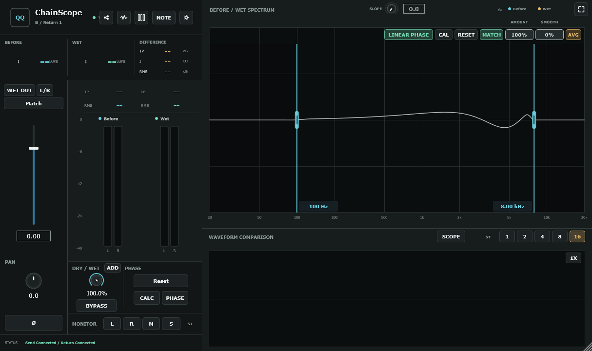
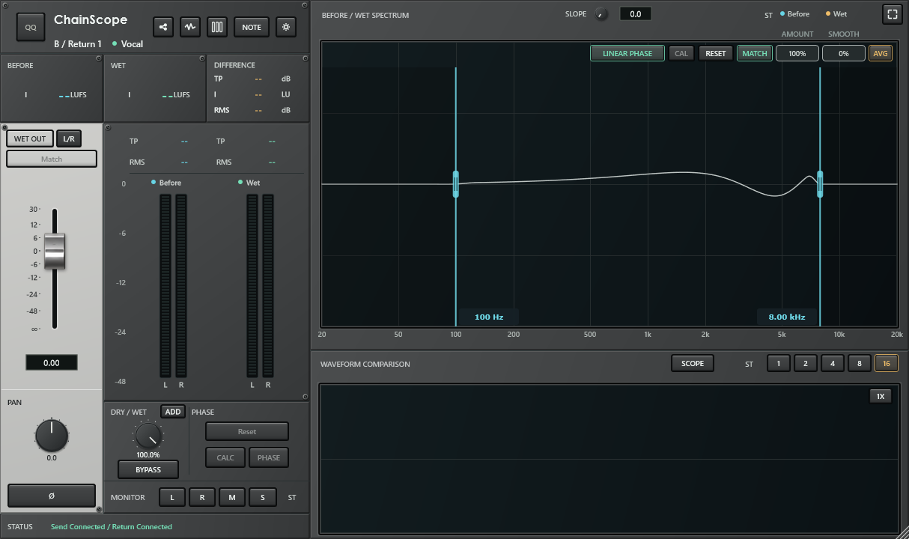
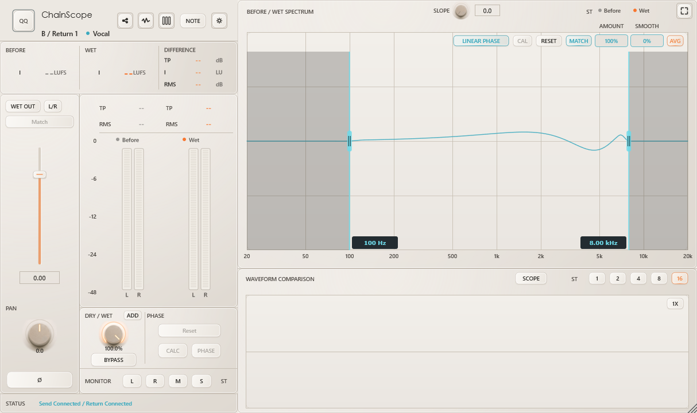
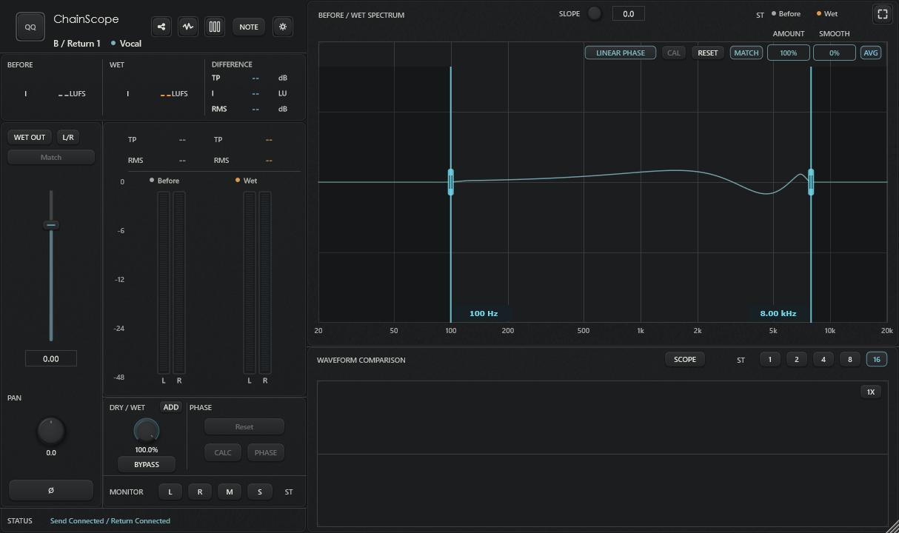

# 插件护士 / QQ ChainScope 1.8.19 Stable

**Qing Audio · 2026-11-03**

## 1. 产品介绍 / About the product

QQ ChainScope 帮你在工程里比较处理前后的声音、匹配音量与音色，并按比例混合不同处理。同轨可以比较原始声音与最多四套效果器方案；多轨可以用 B Return 管两轨，或用 D Mixboard 控制最多六个分轨。

QQ ChainScope helps you compare audio before and after processing, match loudness and tone, and blend processing choices. On one track, compare Original with up to four effects chains. Across tracks, use B Return for two tracks or D Mixboard for up to six.

### 它能帮你做的 13 件事 / Thirteen things it helps you do

| # | 中文 | English |
|---|---|---|
| 1 | **对比处理前／后**：查看 Peak、True Peak、RMS、LUFS-I、Spectrum 与 Waveform。 | **Compare before and after**: View Peak, True Peak, RMS, LUFS-I, Spectrum, and Waveform. |
| 2 | **匹配前／后音量**：用 Match 减少“更响所以更好听”的误判。 | **Match before / after loudness**: Use Match to avoid mistaking louder for better. |
| 3 | **Dry / Wet 与 ADD Wet**：混合原声（Dry）与效果器处理后的声音（Wet）；打开 ADD，可保持原声 100%，再把处理后的声音叠加上去。 | **Dry / Wet and ADD Wet**: Blend the original sound (Dry) with the sound after effects (Wet). Enable ADD to keep Dry at 100% and layer the processed sound on top. |
| 4 | **校准相位偏移**：检查并修正处理链带来的相位偏移。 | **Correct phase offsets**: Inspect and correct phase offsets introduced by the processing chain. |
| 5 | **校准硬件左右电平**：修正硬件额外引入的 L/R 失配，保留素材原有的立体声关系。 | **Calibrate hardware L/R levels**: Correct the extra L/R mismatch introduced by hardware while preserving the source stereo relationship. |
| 6 | **修正残余延迟**：部分插件误报延迟，导致 DAW 无法正确补偿时，用 Latency Rescue 补齐。 | **Correct residual latency**: If a plug-in reports the wrong latency and the DAW cannot compensate correctly, use Latency Rescue to close the gap. |
| 7 | **EQ Match 音色匹配**：让 Wet 或 Main Out（Dry/Wet 混合后的信号）的音色接近 Before，自由调整匹配强度和频段。 | **Match tone with EQ Match**: Bring Wet or Main Out (the signal after Dry/Wet mixing) closer to Before. Adjust the correction amount and frequency range. |
| 8 | **查看轨道间的遮蔽效应**：在 C/D Mixboard 的 OVERLAY 中开启 MASKING，通过频谱和 Waveform 阴影查看轨道间可能存在的遮蔽。 | **Check masking between tracks**: Enable MASKING in C/D Mixboard OVERLAY to see possible masking between tracks as shading on the spectrum and waveform. |
| 9 | **把硬件现场留在工程里**：用 Chain Note 保存旋钮照片、接线、参数与备注。 | **Keep hardware notes in the session**: Use Chain Note to save knob photos, patching, settings, and comments. |
| 10 | **单轨比较或混合多套方案**：用 C Mixboard 比较处理前的原始信号和最多四组效果器方案的差异，或按比例混合。 | **Compare or mix chains on one track**: Use C Mixboard to compare the original signal with up to four effects chains, or blend them by percentage. |
| 11 | **跨轨对比与混合**：用 B Return 对比两条轨道，通过 Dry/Wet 调整两轨的音量比例。 | **Compare and blend two tracks**: Use B Return to compare two tracks and adjust their level balance with Dry/Wet. |
| 12 | **集中控制六路声音**：用 D Mixboard 控制最多六个分轨，进行比较、混合、监听和 EQ Match。 | **Control up to six tracks**: Use D Mixboard to compare, mix, monitor, and EQ Match up to six tracks. |
| 13 | **独立分析与监听**：B Return、C Mixboard、D Mixboard 可独立查看图表，调节音量、声像、极性与监听。 | **Standalone analysis and monitoring**: Use B Return, C Mixboard or D Mixboard on its own to view graphs and control level, pan, polarity, and monitoring. |

### 四类组件与连接 / Components and connection

| 插件 / Plug-in | 用途 / Purpose |
|---|---|
| A Send | 留下原始参考并建立 Group。/ Capture Original and establish a Group. |
| B Return | 处理前后测量、校准与 Dry/Wet；也可作两轨控制器或 Standalone。/ Measure, calibrate, and blend Dry/Wet; also two-track control or Standalone. |
| C Mixboard | 同轨 Original + 最多四个 Return；Standalone 时处理本轨的图表和监听。/ Original plus up to four same-track Returns; local analysis and monitoring in Standalone. |
| D Mixboard | 遥控最多六轨，第一路为 Before；各轨沿原路由出声。/ Control up to six tracks; lane 1 is Before and audio remains on each source track. |

**单轨 / Single track:** `A Send → 效果器 / effects → B Return (FINAL) → C Mixboard（可选 / optional）`。多 Return 时，最后一个 Return 必须为 FINAL，各套处理都从同一个 Original 出发；C 放在 FINAL 后面。

With multiple Returns, set the physically last Return to FINAL; every chain starts from the same Original. Place C after FINAL.

**多轨 / Multi Track:** 各轨最后的 A/B/C 点亮三个竖长方形图标。B 选择另一轨带 `[Multi Track]` 的 Group 来控制两轨；D 选择最多六个 Group。D 可挂在任意轨道，自身不增加音频延迟，音量、Monitor 和隐藏 EQ 在各轨 A/B/C 中生效。

Enable the three-rectangle icon on the final A/B/C in each participating track. B selects another track's `[Multi Track]` Group for two-track control; D selects up to six Groups. D can be placed anywhere and adds no audio latency itself. Level, Monitor, and hidden EQ processing run in the source A/B/C plug-ins.

原始轨给其他轨发送时，把 A Send 放在推子后 Insert，并使用推子前发送，避免 Compare 静音 Original 时把其他轨的输入也切断。旁通 D 后遥控参数仍有效；删除 D 会清除其相关隐藏处理。完整步骤及 C/D 旁通差异见随包手册。

When the original feeds other tracks, place A Send in a post-fader insert slot and use pre-fader sends so muting Original in Compare keeps those tracks fed. Bypassing D leaves remote settings active; removing D clears its related hidden processing. The included manuals explain the full steps and C/D bypass differences.

### EQ Match

Wet 与 Main Out（Dry/Wet 混合后的信号）都能匹配到 Before，分别保存设置。B/C/D 提供线性相位开关、Amount、Smooth 与匹配后可拖动的频率范围。切换相位模式时，DAW 更新延迟补偿可能造成短暂断音。

Wet and Main Out (the Dry/Wet blend) can both match Before and keep separate settings. B/C/D offer a phase-mode switch, Amount, Smooth, and frequency boundaries adjustable after matching. Changing phase mode may briefly interrupt audio while the DAW updates compensation.

### 四种界面 / Four UI styles

Classic、SSL、Light、Dark 功能相同。A Send 在主界面 **UI STYLE** 中选择；B Return、C Mixboard、D Mixboard 在顶部 **Settings 齿轮 → UI STYLE** 中选择。

Classic, SSL, Light, and Dark share the same functions. A Send: **UI STYLE** on the main panel. B Return, C Mixboard, D Mixboard: **top Settings gear → UI STYLE**.

#### Classic

#### SSL

#### Light

#### Dark

### OVERLAY 与 MASKING / OVERLAY and MASKING

C/D 的 OVERLAY 以 dB 调整各路并分别显示图表，与 MIX 共用音量。眼睛控制显示及 Link 范围；MIX/OVERLAY 右键音量块独立静音。MASKING 默认关闭，SENS 默认 20、REF SPL 默认 75，提供频率和时间阴影。它仍是试验性听辨辅助，不会自动改动声音。

C/D OVERLAY uses dB gains and separate source graphs, sharing gains with MIX. Eyes select display and Link participation; right-click gain blocks for independent MIX/OVERLAY mute. MASKING is off by default, with SENS 20 and REF SPL 75. Its frequency/time shading is experimental listening assistance and does not change audio automatically.

随包沿用 v1.8.18 中英文手册，各 62 页，包含 OVERLAY、Link、静音和 MASKING 参数图解。

The included v1.8.18 manuals retain 62 pages each with illustrated OVERLAY, Link, mute and MASKING guidance.

### FINAL 规则 / FINAL Rules

- 同一个 Group 正常情况下只有一个 FINAL。

- 物理位置最后的参与 Return 必须是 FINAL。

- Mixboard 必须放在 FINAL 后面。

- R1-R4 是稳定身份/颜色，不代表物理 Insert 顺序。

- 新建 R2/R3/R4 时，系统在自动阶段让最新 Return 成为 FINAL；第一次手动点 FINAL 后进入 Manual Final Lock。

- Deactivate FINAL 不会转移身份；真正删除该 Return 才触发 fallback。

  

### 问题与反馈 / Bugs & Feedback

请使用本仓库的 **[Issues](https://github.com/Qing-Audio/Plugin-Nurse-QQ-ChainScope-Release/issues)** 提交可复现问题，并尽量附上：

- 操作系统与版本；

- DAW 与版本；

- VST3 / AU；

- x64 / arm64；

- ChainScope 版本；

- Single Return / Multi Return；

- 实际 Insert 顺序；

- 复现步骤；

- 截图、录屏或工程片段（如果方便）。

For reproducible bug reports, include OS, DAW/version, plug-in format/architecture, ChainScope version, Single/Multi Return topology, actual insert order, reproduction steps, and screenshots/video when possible.

## 2. 许可证 / License

QQ ChainScope 为 Qing Audio 的专有软件，不开源。公开下载仅包含编译后的插件成品与文档，不包含源码。

QQ ChainScope is proprietary Qing Audio software and is not open source. Public downloads contain compiled plug-ins and documentation only, with no source code.

## 3. 最新版本下载与说明书 / Latest downloads and manuals

**[QQ ChainScope 1.8.19 Release](https://github.com/Qing-Audio/Plugin-Nurse-QQ-ChainScope-Release/releases/tag/v1.8.19)**

- [QQ-ChainScope-1.8.19-Windows-x64-VST3.zip](https://github.com/Qing-Audio/Plugin-Nurse-QQ-ChainScope-Release/releases/download/v1.8.19/QQ-ChainScope-1.8.19-Windows-x64-VST3.zip)
- [QQ-ChainScope-1.8.19-macOS-Apple-Silicon-VST3.zip](https://github.com/Qing-Audio/Plugin-Nurse-QQ-ChainScope-Release/releases/download/v1.8.19/QQ-ChainScope-1.8.19-macOS-Apple-Silicon-VST3.zip)
- [QQ-ChainScope-1.8.19-macOS-Intel-x86_64-VST3.zip](https://github.com/Qing-Audio/Plugin-Nurse-QQ-ChainScope-Release/releases/download/v1.8.19/QQ-ChainScope-1.8.19-macOS-Intel-x86_64-VST3.zip)
- [QQ-ChainScope-1.8.19-macOS-Universal-2-AU.zip](https://github.com/Qing-Audio/Plugin-Nurse-QQ-ChainScope-Release/releases/download/v1.8.19/QQ-ChainScope-1.8.19-macOS-Universal-2-AU.zip)
- [QQ ChainScope 1.8.19 安装说明（中文版）.txt](https://github.com/Qing-Audio/Plugin-Nurse-QQ-ChainScope-Release/releases/download/v1.8.19/QQ.ChainScope.1.8.19.txt)
- [QQ-ChainScope-1.8.19-Installation-Guide-English.txt](https://github.com/Qing-Audio/Plugin-Nurse-QQ-ChainScope-Release/releases/download/v1.8.19/QQ-ChainScope-1.8.19-Installation-Guide-English.txt)
- [QQ ChainScope 用户手册（中文版）v1.8.18.pdf](https://github.com/Qing-Audio/Plugin-Nurse-QQ-ChainScope-Release/releases/download/v1.8.19/QQ.ChainScope.v1.8.18.pdf)
- [QQ ChainScope User Manual English v1.8.18.pdf](https://github.com/Qing-Audio/Plugin-Nurse-QQ-ChainScope-Release/releases/download/v1.8.19/QQ.ChainScope.User.Manual.English.v1.8.18.pdf)

- 中文：各平台包均含 A/B/C/D 四件套，请一起升级到 1.8.19。升级前保存工程副本并关闭音频宿主。原有工程与参数保持兼容。
- English: Every platform package contains A/B/C/D; upgrade all four to 1.8.19. Save a session copy and close audio hosts before replacement. Existing sessions and parameters remain compatible.
- 中文：Windows x64 VST3 复用已验证构建；Mac VST3 按宿主选择 Apple Silicon 或 Intel/Rosetta，两套只装一套；AU 使用 Universal 2。Mac 采用 ad-hoc 签名，未经过 Apple Developer ID 公证。
- English: The verified Windows x64 VST3 build is reused. Choose Apple Silicon or Intel/Rosetta VST3 for the Mac host and install only one; AU uses Universal 2. Mac products use ad-hoc signatures without Apple Developer ID notarization.
- 中文：沿用已发布的 v1.8.18 中英文手册，各 62 页，内容与版本标识不变。本次新增 Shift + 滚轮平移及波形右键恢复全览，见下方更新记录和随包安装说明。
- English: The released 62-page v1.8.18 Chinese and English manuals are included unchanged with their original version labels. See the change history and included guides for Shift + wheel panning and right-click waveform overview reset.
- 中文：MASKING 仍为试验性辅助分析（SENS 默认 20、REF SPL 默认 75）。自动化构建和插件接口测试不等于所有 DAW、实体控制器及监听条件都已验收。
- English: MASKING remains experimental visual assistance (SENS 20 and REF SPL 75 by default). Automated build and plug-in interface tests do not certify every DAW, physical controller or listening setup.

### 安装、升级与兼容性 / Installation, upgrades and compatibility

- Windows 10/11 x64，安装到 `C:\Program Files\Common Files\VST3`。macOS 部署目标为 11.0 或更高；VST3 放到 `~/Library/Audio/Plug-Ins/VST3`，AU 放到 `~/Library/Audio/Plug-Ins/Components`。

- 关闭 DAW 后更新完整四件套，避免用户目录、系统目录或旧命名下有重复版本，然后重新扫描。D 从 1.7.x 起随四件套提供。

- macOS 成品为 ad-hoc 签名，未经过 Apple Developer ID 公证。需要处理 quarantine 时，按随包安装说明操作。

- QQ Host 内的跨进程多轨兼容仍待处理。DAW 路由、轨道身份和延迟补偿行为可能影响跨轨连接与切换；插件应处于各参与轨处理链的最后。新装后先用工程副本检查。

- Windows 10/11 x64: `C:\Program Files\Common Files\VST3`. macOS deployment target: 11.0 or later. Use `~/Library/Audio/Plug-Ins/VST3` for VST3 and `~/Library/Audio/Plug-Ins/Components` for AU.

- Quit the DAW, update the complete four-plug-in set, remove duplicate old copies, and rescan. D is included in the four-plug-in set from 1.7.x onward.

- macOS builds are ad-hoc signed and not Apple Developer ID notarized. Follow the included installation guide if quarantine prevents loading.

- QQ Host cross-process Multi Track remains pending. DAW routing, track identity, and delay compensation can affect cross-track connections and transitions. Put each participating endpoint last in its track's chain, and check a copy of the session after upgrading.

中英文手册均为 v1.8.18，各 62 页；功能概览已更新为 13 项，保留原有配色、文字风格与图解。Graph、频谱、波形及放大操作有独立章节；播放中计算、SIP、发送与轨道名称来源也有图文说明。原有四种界面截图保留其实际版本标识。

Both 62-page v1.8.18 manuals include the 13-item overview while retaining their established colors, writing style and illustrations. A dedicated chapter covers Graph, spectrum, waveform and the expand button, with illustrated guidance for live calculations, SIP, sending and track names. Existing UI-style screenshots keep their original version labels.

中英文手册各 54 页，已同步高精度 TP、图表差值、SOURCE LEVELS 与全局/局部 ECO/FULL 的说明。

Both 54-page manuals cover improved TP precision, named graph differences, SOURCE LEVELS and global/local ECO/FULL.

## 4. 逐版本更新记录 / Version history

### 1.8.19 — 频谱显示与波形导航 / Spectrum display and waveform navigation

- 中文：修复 B Return WET OUT 频谱受到无关 Dry/Wet、ADD 或 MAIN 控制影响的问题；B MAIN OUT 与 C/D MIX 调整音量、混合与静音时，实时曲线继续平滑更新，避免整幅图突然跳动。停止后的历史结果仍即时响应相关控制。
- English: Fixes B Return WET OUT spectrum invalidation caused by unrelated Dry/Wet, ADD or MAIN controls. Live curves in B MAIN OUT and C/D MIX keep smoothing during gain, blend and mute changes instead of snapping the whole view. Relevant controls still update held results immediately after Stop.
- 中文：B/C/D 的 Waveform / WaveScope 新增 Shift + 滚轮左右平移；在波形区域右键恢复全览，横向与纵向缩放回到 1 倍，保留已记录波形与拍数设置。中文悬停说明同步更新。
- English: B/C/D Waveform / WaveScope add Shift + wheel panning and right-click full-view reset. Both axes return to 1x while captured waveforms and beat duration are preserved. Chinese hover help is updated.
- 中文：音频处理、TP/LUFS/RMS 测量、自动化参数与路由保持原有含义。中英文手册按要求沿用已发布 v1.8.18 原文件；本次快捷键见更新记录和安装说明。
- English: Audio processing, TP/LUFS/RMS metering, automation parameters and routing retain their existing meanings. The released v1.8.18 manuals are reused unchanged as requested; see the change notes and installation guides for the new shortcuts.

### 1.8.18 — MIDI 全范围音量映射 / Full-range MIDI level mapping

- 中文：C/D Mixboard 新增 SOURCE n LEVEL 完整范围参数，音量块可通过 Cubase MIDI Remote／快速控制从静音控制到 +12 dB（约 398.1%）。修正绑定到 BOOST 后最低位置只能到绑定时音量的问题。若已有映射选择了 SOURCE n BOOST，请重新学习音量块或手动选择 SOURCE n LEVEL。

- English: C/D Mixboard now expose full-range SOURCE n LEVEL parameters, allowing Cubase MIDI Remote / Quick Controls to control gain blocks from silence to +12 dB (about 398.1%). This fixes mappings to BOOST being unable to go below the gain present when learned. Relearn the gain block or select SOURCE n LEVEL if an existing mapping targets SOURCE n BOOST.

- 中文：B/C/D 单推子和 L/R 推子的学习通知、点击目标已修正，使用原有静音至 +30 dB 的绝对范围；旧参数编号、范围与工程状态保持兼容。原有 Link、音频处理和图表功能保持不变。

- English: Learning notifications and hit targets are corrected for B/C/D single and L/R faders, retaining the absolute range from silence to +30 dB. Existing parameter identifiers, ranges and saved states remain compatible. Link, audio processing and graph behavior are unchanged.

- 中文：2026-10-27 文档补充：中英文手册功能概览更新为 13 项，MASKING 位于第 8 项；第 13 项加入 D Mixboard 的独立分析与监听。插件成品保持不变。

- English: Documentation update, 2026-10-27: both manuals now list 13 capabilities, with MASKING at item 8 and D Mixboard included in standalone analysis and monitoring at item 13. Plug-in binaries are unchanged.

### 1.8.17

- 中文：修复播放中跳转位置后 C/D 的 COMPARE、OVERLAY 频谱保留旧曲线、后续更新停滞的问题。保留既有音频处理、测量算法与累计规则。

- English: Fixes stalled COMPARE/OVERLAY spectrum updates after playback seeks in C/D Mixboard. Audio processing, meter algorithms and accumulation rules are preserved.

### 1.8.16

- 中文：MASKING 的 SENS 默认值调整为 20，Alt 恢复 20；已保存的实例数值不被覆盖。中文手册补充 SENS、REF SPL、多轨选择和阴影示例。

- English: Sets the default MASKING SENS to 20, including Alt reset, without overwriting saved instance values. Adds Chinese manual examples for SENS, REF SPL, source selection and shading.

### 1.8.15

- 中文：ECO 下展开 Graph 时同时维护 COMPARE、OVERLAY、MIX 图表，修复来回切换后频谱消失。收起 Graph 或关窗后仍按 ECO 规则节省分析。此版将 SENS 默认值设为 30，后续 1.8.16 改为 20。

- English: Keeps all three graph modes ready while Graph is open in ECO, fixing missing spectra after mode changes. Collapsing Graph or closing the window retains ECO savings. This version used SENS 30; 1.8.16 supersedes it with 20.

### 1.8.14

- 中文：降低图表快照与历史重建对线程栈的占用，修复在 QQ Host 较小线程栈下可能导致断线的路径，保留图表与音频功能。

- English: Reduces stack use in graph snapshots and history projection, addressing a disconnect path on QQ Host threads with smaller stacks while preserving audio and graph behavior.

### 1.8.13

- 中文：为 C/D 的 OVERLAY 增加独立 SENS 灵敏度参数、保存和精细调整。此版默认 50，后续版本继续调整默认值。

- English: Adds a saved, finely adjustable SENS control to C/D OVERLAY. The initial default was 50; later versions refine that default.

### 1.8.12

- 中文：进一步收紧 MASKING 对微弱尾部和不显著重叠的判断，减少过多阴影提示。

- English: Makes MASKING more selective about weak tails and insignificant overlap to reduce excessive shading.

### 1.8.11

- 中文：MASKING 增加渐亮、渐暗和平滑处理，减少闪烁，并继续降低过度敏感的提示。

- English: Smooths MASKING shading with gradual attack and release, reducing flicker and over-sensitive indications.

### 1.8.10

- 中文：B 的音量、PAN、Dry/Wet 以及 C/D MIX 的音量与静音可重新呈现已记录的图表，停止后也能查看变化；C/D 模式顺序改为 COMPARE、OVERLAY、MIX。

- English: Updates retained graphs for B gain, PAN and Dry/Wet and C/D MIX gain and mute, including while stopped. Orders C/D mode buttons as COMPARE, OVERLAY, MIX.

### 1.8.9

- 中文：MASKING 改为眼睛点亮来源之间的两两分析，移除参考轨和 AUTO/PAIR 的额外选择。C 增加与 D 一致的 OVERLAY、dB 音量与 Link；右键静音采用更深的黑色。

- English: Uses pairwise MASKING across sources with lit eyes, removing the extra reference-track and AUTO/PAIR choices. Adds matching OVERLAY, dB gain and Link behavior to C. Muted source blocks use a deeper black.

### 1.8.8

- 中文：减少 MASKING 对很弱成分的误提示，统一频谱与波形的遮蔽可见条件。

- English: Reduces MASKING indications from very weak components and aligns spectrum and waveform visibility criteria.

### 1.8.7

- 中文：眼睛仅控制图表、数值显示及 Link/Alt 参与范围，不再决定声音是否混合。MIX/OVERLAY 中右键独立静音；COMPARE 右键不静音。解除 D 连接时释放遥控静音。

- English: Separates eye-controlled display and Link/Alt participation from audio mixing. Adds independent right-click mute in MIX/OVERLAY, with no right-click mute in COMPARE. Disconnecting D releases its remote mute.

### 1.8.6

- 中文：加入首版 MASKING 与 REF SPL、频率和时间阴影；进一步放慢音量调整。MIX Link 保持总百分比，OVERLAY Link 同步增减 dB。无 Before 时仍显示 After，禁用新 EQ Match 计算但保留已有结果。B/D 解除连接时释放隐藏遥控处理，重新连接后按当前控制器状态恢复。

- English: Introduces MASKING, REF SPL and frequency/time shading, with slower gain adjustment. MIX Link preserves the total percentage; OVERLAY Link applies equal dB changes. After remains available without Before; new EQ Match calculation is disabled but existing results remain. Disconnecting B/D releases hidden remote processing, and reconnection reapplies the current controller state.

### 1.8.5

- 中文：放慢 C/D 音量操作；OVERLAY 的 Alt 恢复 0 dB，MIX 保留平均分配。全局 ECO/FULL 记住用户上次选择，独立于新实例默认 FULL。

- English: Slows C/D gain controls. Alt resets OVERLAY to 0 dB while MIX retains equal-share reset. The global ECO/FULL choice persists independently of new instances starting in FULL.

### 1.8.4

- 中文：D 的 OVERLAY 使用 dB 显示，与 MIX 百分比互相换算，最大 +12 dB。超过 100% 时颜色填充仍限制在音量块边界。

- English: Displays D OVERLAY gain in dB, sharing values with MIX percentages up to +12 dB. Fill remains bounded when percentages exceed 100%.

### 1.8.3

- 中文：将 D 的新模式命名为 OVERLAY，修复单路频谱显示并计入音量；保留与 MIX 共用的混合音量和 Link，以及流畅的模式切换。

- English: Renames the new D mode OVERLAY, fixes per-source spectra with applied gain, and retains shared MIX gains, Link and smooth mode changes.

### 1.8.2

- 中文：为 D 加入首次交付时名为 FULL 的叠加分析模式：共用 MIX 的音量和 Link，分别查看各 Group 的图表与数值，同时显示总 MIX。此名称在 1.8.3 改为 OVERLAY。

- English: Introduces D's layered analysis mode, initially named FULL, with shared MIX gains and Link, per-Group graphs/readings and the total MIX result. Version 1.8.3 renames it OVERLAY.

### 1.8.1

- 中文：配合 QQ Host 1.3.6 的多段处理，使用音频块标记和采样位置配对 Original、Return 与混合音频，保留插件延迟对齐。完整且位于同一 QQ Host 的 A/B/C 组可以参与分段；旧版、不完整、跨 Host 及 D 组继续保留分段保护。现有界面、DSP、测量、预置和说明书保持不变。A/B/C/D 四个模块必须一起升级。

- English: Adds audio-block and sample-position matching for Original, Returns and mixed audio under QQ Host 1.3.6 multistage processing, retaining declared-latency alignment. Complete A/B/C groups contained within one QQ Host can use multiple stages. Older, incomplete, cross-Host and D groups keep pipeline protection. Existing UI, DSP, metering, presets and manuals are retained. Upgrade all four A/B/C/D modules together.

### 1.7.26

- 中文：C/D 新增按来源名称、颜色和位置对应的 TP、综合响度与 RMS。FULL/ECO 都从播放起点持续累计 MIX，停止后保持，模式切换不清零。

- English: C/D add source TP, integrated loudness and RMS readings matching source names, colors and positions. FULL/ECO continuously accumulate MIX from Play and retain it through Stop and mode changes.

### 1.7.27

- 中文：COMPARE 数值区移到来源按钮与 Monitor 之间；MIX 卡片直接显示数值，列顺序统一为 I / RMS / TP。MIX 页移除重复卡片；设置页隐藏顶部局部模式按钮及 B 的 NOTE。

- English: COMPARE readings move between source selection and Monitor; MIX readings are visible with I / RMS / TP column order. MIX removes duplicate cards; Settings hides the local mode button and B NOTE.

### 1.7.28

- 中文：C 只显示实际 Return，D 只显示可用的已连接 Group；试听、比例与数值区紧凑排列，名称、颜色和真实连接关系保持一致。

- English: C shows existing Returns and D shows connected available Groups. Listening, proportions and reading cards use compact matching names, colors and connections.

### 1.7.29

- 中文：设置中的全局 ECO/FULL 显示最近的全局选择，与当前单个插件的模式分开。点击全局会更新所有现有 B/C/D，单个调整不改全局显示。中英文手册补充数值、动态来源与全局/局部模式示例。

- English: Settings shows the last global ECO/FULL choice separately from the local instance mode. Global clicks update all existing B/C/D; local changes leave the global display unchanged. Bilingual manuals add source readings, dynamic-source and global/local examples.

### 1.7.30

- 中文：B/C/D 波形悬停改为一行带名称和相减顺序的差值；频谱使用“平均差／峰值差”，保留频率及两路名称。

- English: B/C/D waveform hover uses one named subtraction. Spectrum uses readable Chinese average/peak difference labels, retaining frequency and both source names.

### 1.8.0

- 中文：提高 True Peak 检测精度；响度、RMS、声音处理、停止保持及重置规则保持不变。中英文手册同步到 1.8.0，补充 TP 及图表差值说明。

- English: Improves True Peak detection precision while preserving loudness, RMS, audio processing, Stop hold and Reset behavior. Both manuals are updated to 1.8.0 with TP and graph-difference guidance.

### 1.7.25 — Stable

- 中文：设置中的 FULL / ECO 一起调整同一宿主进程里已经插入的 B Return、C Mixboard 和 D Mixboard，关闭窗口的插件也会跟随；后来新插入的插件仍默认 FULL，保存的工程保留各插件自己的模式。B/C/D 齿轮左侧新增单个插件的 ECO/FULL 按钮，并跟随全局调整。按钮、旋钮、菜单和数值框增加中文悬停说明。中英文手册各 51 页，新增配图说明。

- English: Settings FULL / ECO now updates existing B Return, C Mixboard and D Mixboard instances in the same host process, including closed editors. New inserts still start in FULL; saved projects retain each instance's mode. A local ECO/FULL button sits immediately left of the gear in B/C/D and follows global changes. Buttons, knobs, menus and value fields gain Chinese hover help. Both manuals have 51 pages, with a new illustrated guide.

### 1.7.23

- 中文：允许播放中点击响度 Match、L/R Cal、PHASE CALC、EQ CAL 和 Latency Rescue。响度 Match、L/R Cal 与 EQ CAL 每次都使用从本次播放起点到点击时的累计数据，重复点击保留记录；停止后重新播放开始新一轮。ECO 下需在播放前打开相应分析界面。

- English: Allows loudness Match, L/R Cal, PHASE CALC, EQ CAL and Latency Rescue during playback. Loudness Match, L/R Cal and EQ CAL use accumulated data from the current playback pass's start to each click, retaining the capture across repeated calculations. Stop and restart for a new pass. In ECO, open the required analysis view before playback.

### 1.7.24 — Stable

- 中文：B Return 在底部 Monitor 行右侧加入 SIP，控制 L/R/S 监听是否保留空间位置。新建实例默认关闭，旧工程保留原来的原位监听方式；Stereo 与 M 不变。中英文手册更新为 50 页，独立介绍 Graph、频谱、波形及放大操作，并补充播放中计算、SIP、发送和名称来源说明。

- English: Adds SIP at the right of B Return's Monitor row to control spatial placement in L/R/S monitoring. New instances default to SIP off; older projects retain their previous in-place monitoring. Stereo and M are unchanged. Both manuals now have 50 pages, with a dedicated Graph chapter and updated live-calculation, SIP, sending and source-name guidance.

### 1.7.17

- 中文：修复 macOS 多个插件实例之间的 Group 与多轨控制信息共享；AU 缺少轨道标识时允许手动选择全部 Group。

- English: Fixes shared Group and remote-control discovery across macOS instances. AU permits manual selection of all Groups when track identity is unavailable.

### 1.7.18

- 中文：补齐 AU 的工程采样位置，让跨轨 Before 测量、波形和 EQ Match 取得参考信号。

- English: Supplies the AU project-sample clock for cross-track Before analysis, waveform and EQ Match reference capture.

### 1.7.19

- 中文：修复 AU 停止播放后 Before 电平的更新状态，保留峰值保持与分析历史。

- English: Fixes AU Before meter freshness after playback stops while retaining peak holds and analysis history.

### 1.7.20

- 中文：修复重新打开工程后已开启的 Multi Track 没有重新注册的问题，无需手动关闭再打开按钮。

- English: Restores saved Multi Track endpoint registration when reopening a project, without requiring a manual toggle.

### 1.7.21

- 中文：修复 AU 起播时短暂漏出 Send 原声的问题，并及时同步停止播放时修改的 QQ Bypass 状态；起播淡入的进一步修复见 1.7.22。

- English: Addresses the brief AU Send burst at playback start and promptly publishes stopped QQ Bypass changes. Further startup fade handling follows in 1.7.22.

### 1.7.22 — Stable

- 中文：修复 AU 与 Windows VST3 起播时的短暂淡入。宿主暂停处理、重新播放时立即使用当前音量比例；播放中的 Bypass crossfade 保留，不增加音频延迟。

- English: Fixes playback-start fades in AU and Windows VST3. Current remote gains apply immediately after processing suspension or playback restart. Existing live Bypass crossfades remain intact, with no added audio latency.

### 1.7.16 — Stable — 2026-10-06

- 中文：EQ Match 的 Amount 扩展为 -200% 到 +200%，负值反向应用匹配曲线，正负 200% 将修正幅度加倍。B Return 的 Wet/Main Out、C/D Mixboard 和多轨端口一致支持；默认值与 Alt 复位仍为 100%，保存、恢复和撤销保留完整范围。其他功能不变，A/B/C/D 四件套请一起更新。

- English: Extends EQ Match Amount to -200% through +200%. Negative values reverse the learned correction; +/-200% doubles its magnitude. B Return Wet/Main Out, C/D Mixboard and remote endpoints support the full range, including save/restore and undo. The default and Alt reset remain 100%; other behavior is unchanged. Update all four A/B/C/D plug-ins together.

### 1.7.15 — Stable — 2026-10-05

- 中文：修复拖动旋钮、推子、百分比、混合比例和频率数值时按下或松开 Shift 导致的参数回跳。切换 Shift 时从当前值继续调整，普通拖动和精细调整的速度保持原样。A/B/C/D 四件套请一起更新。

- English: Fixes parameter jumps when pressing or releasing Shift during knob, fader, percentage, mix-weight and frequency drags. Adjustment continues from the current value when Shift changes; normal and fine sensitivities are retained. Update all four A/B/C/D plug-ins together.

### 1.7.14 — Stable — 2026-09-30

- 中文：优化 C Mixboard、D Mixboard 在 ECO 模式、关闭界面后的处理开销。C 的 MIX 不再要求 B Return 持续计算不需要的频谱；D 减少重复控制更新和空闲处理。音频路由、EQ Match、延迟和切换行为保持原样。A/B/C/D 四件套请一起更新。

- English: Reduces processing in C Mixboard and D Mixboard in ECO mode with their windows closed. C MIX no longer keeps B Return computing an unneeded shared spectrum; D avoids repeated control updates and idle work. Audio routing, EQ Match, latency and switching behavior remain unchanged. Update all four A/B/C/D plug-ins together.

### 1.7.13 — Stable — 2026-09-27

- 中文：修复 TP 对部分采样点间峰值的低估，采用 ITU-R BS.1770-5 附录 2 的过采样滤波测量；修复 Peak 在两次界面刷新之间漏掉短促峰值的问题。音频处理、路由、EQ Match、延迟和原有 TP 保持／复位规则不变。A/B/C/D 四件套请一起更新。

- English: Fixes underestimated inter-sample True Peaks using the oversampling measurement filter from ITU-R BS.1770-5 Annex 2, and prevents short sample peaks from being missed between display refreshes. Audio processing, routing, EQ Match, latency and the existing TP hold/reset behavior are unchanged. Update all four A/B/C/D plug-ins together.

### 1.7.12 — Stable; public release withdrawn / 已撤回公开发布 — 2026-09-27

- 中文：修复 A Send、B Return、C Mixboard 顶部 Multi Track 按钮缩放不一致、压住相邻按钮的问题。声音处理不变。该版本的发布构建已取消，本次 1.7.13 包含此修复。

- English: Fixes inconsistent scaling of the Multi Track header button in A Send, B Return and C Mixboard, preventing overlap with nearby buttons. Audio processing is unchanged. Its release builds were cancelled; 1.7.13 includes this fix.

### 1.7.11 — Stable

- 中文：B Return 在 Standalone、同轨 Group、跨轨 Group 之间切换或重新连接时保留 Wet/Main Out 的 EQ Match；C Mixboard 进入或离开 Standalone、C/D 切换 Group 时同样保留。保存并重新打开时不再因参考 Group 已改变而丢失匹配。调整 EQ 精度保留结果及开关状态。主动 Reset、整组同步重置和采样率变化仍清空。其他声音处理和界面保持原样。

- English: B Return retains Wet/Main Out EQ Match across Standalone, same-track and cross-track Group changes and reconnections. C retains EQ when entering/leaving Standalone; C/D retain it when changing Groups. Reloading a saved state no longer drops EQ because the reference Group changed. Changing EQ quality preserves the learned result and Match state. Explicit Reset, whole-set synchronise reset and sample-rate changes still clear EQ. Other audio behavior and the UI are unchanged.

### 1.7.10 — previous Candidate, superseded by 1.7.11 / 已由 1.7.11 替代的候选版

- 中文：修复 B Return 从跨轨模式切换到 Standalone 时丢失已计算的 Wet/Main Out EQ Match，并保留保存恢复后的效果。重新连接其他 Group 时仍会清空的问题由 1.7.11 补齐。

- English: Fixed loss of learned Wet/Main Out EQ when B Return detached from cross-track mode into Standalone, including saved-state restoration. The remaining loss on reconnection to another Group is addressed in 1.7.11.

### 1.7.9 — EQ Match alignment / EQ Match 对齐

- 中文：修复最小相位下 Before/Dry 与 Match 旁通路径多出约 80 ms 延迟的问题，涉及 B Return、C Mixboard 和 D 控制的发送端。保留线性相位补偿与现有 EQ 设置。

- English: Fixes approximately 80 ms of unintended delay in minimum-phase Before/Dry and Match bypass paths, affecting B Return, C Mixboard and D-controlled endpoints. Linear-phase compensation and existing EQ settings are retained.

### 1.7.8 — Side/Mid waveforms / Side、Mid 波形

- 中文：修复 Side 已无声却仍显示波形的问题，并修正反相声道的 Mid 波形；覆盖 B/C/D、停止后的监听切换及 WaveScope。

- English: Fixes false Side waveforms for identical channels and false Mid waveforms for opposite-polarity channels across B/C/D, including stopped monitoring changes and WaveScope.

### 1.6.3 — 停播与测量保留 / Stop behavior and retained measurements

- 中文：修正 QQ Host 内停播后重复播放旧缓冲造成的拖尾；实际延迟播放完后归零。停止后保留 Match、Cal、PHASE 和 EQ Match 的测量参考，重置时清除。

- English: Fixed repeated stale-buffer tails after stopping inside QQ Host. Output becomes silent after the actual delayed audio finishes. Match, Cal, PHASE, and EQ Match references remain available after Stop and clear on reset.

### 1.6.4 — 清晰文字与 Send 皮肤 / Readable text and Send skins

- 中文：SSL、Light、Dark 的小字放大加粗；顶部插件身份和 Group 名称更清楚，Group 名称紧跟身份显示。A Send 加入四种皮肤，在主界面 UI STYLE 中选择。该版本曾由用户指定为 Stable。

- English: Enlarged and strengthened small text in SSL, Light, and Dark. The plug-in identity and Group name are easier to read, with the Group beside the identity. A Send gains all four skins through UI STYLE on its main panel. This version was a user-designated Stable baseline.

### 1.7.0 — 多轨开发与复制轨道连接 / Multi-track development and copied-track links

- 中文：加入 Multi Track 开关和 D Mixboard 的初版五路接收方案；B/C 的普通 Group 列表按宿主提供的轨道信息筛选。复制 Cubase/Nuendo 整轨后，新 Send 建立独立副本 Group，Return 和 C 尝试保留原连接关系。初版跨轨接收仍有宿主时序和延迟问题，随后在 1.7.1 改为遥控方案；初版接收器不作为当前功能提供。

- English: Introduced Multi Track controls and an initial five-source D Mixboard receiver. B/C filter ordinary Groups using host track information. Duplicating a complete Cubase/Nuendo track creates an independent copied Send Group, and Return/C attempt to retain the original link arrangement. Host timing and latency issues in the initial receiver led to the remote-control redesign in 1.7.1; that receiver is not the current architecture.

### 1.7.1 — 六路多轨遥控 / Six-track remote control

- 中文：D 改为最多六路的遥控器，自身不增加音频延迟；各轨 A/B/C 继续通过原路由出声，并在内部执行最终音量、Monitor 与 EQ Match。第一路作为 Before，隐藏 EQ 的延迟由 D 统一设置。删除 D 清除相关隐藏处理，圆形箭头可重新同步。完善 FULL/ECO、Alt+Link 和工程恢复。原始轨给其他轨发送时，应把 A Send 放在推子后，并使用推子前发送。

- English: Redesigned D as a controller for up to six tracks with no audio latency of its own. Each source A/B/C keeps its original audio routing and applies final level, Monitor, and EQ Match internally. Lane 1 is Before; D sets a common hidden EQ delay. Removing D clears its hidden processing, and the circular arrow resynchronizes linked settings. Refined FULL/ECO, Alt+Link, and session restoration. When the original feeds other tracks, place A Send post-fader and use pre-fader sends.

### 1.7.2 — B Input 撤销 / B Input undo

- 中文：修正 B Return 的 Input 调节不能 Ctrl+Z／Ctrl+Shift+Z 的问题，涵盖拖动、滚轮、键盘、数值输入和重置。本版本已构建，但安装被宿主占用阻止，随后由 1.7.3 接替。

- English: Fixed Ctrl+Z / Ctrl+Shift+Z for B Return Input changes, including dragging, wheel, keyboard, numeric entry, and reset. This candidate was built, but installation was blocked by running hosts and it was superseded by 1.7.3.

### 1.7.3 — D 切换过渡 / D switching transitions

- 中文：保留 Input 撤销修复，将 D 的切换过渡从 20 ms 延长到 50 ms，缓解原始轨与发送处理轨切换时的短暂断音；D 自身仍不增加音频延迟。实际效果仍受 DAW 路由与各轨延迟补偿影响。

- English: Retained the Input undo fix and lengthened D transitions from 20 ms to 50 ms to reduce brief gaps when switching between the original and send-fed processing tracks. D still adds no audio latency. Actual results depend on DAW routing and track compensation.

### 1.7.4 — C Standalone

- 中文：C 的 Group 菜单新增 None [Standalone]。Compare 与 Mix 都只有本轨 Original，可看频谱和波形，并使用 Monitor、推子、L/R、Pan 与极性；After 跟随输出调节。该版本曾由用户指定为 Stable。

- English: Added None [Standalone] to C's Group menu. Compare and Mix contain only the local Original, with spectrum, waveform, Monitor, output fader, L/R, Pan, and polarity controls. After follows output adjustments. This version was a user-designated Stable baseline.

### 1.7.5 — B 两轨与新版 EQ Match / B two-track mode and expanded EQ Match

- 中文：B 可以选择其他轨的 [Multi Track] Group，通过 Dry/Wet 或 ADD 控制两轨音量配比；音频仍由各轨输出。B 的 Wet 和 Main Out 分别保存 EQ Match。B/C/D 新增 LINEAR PHASE 开关及匹配后可拖动的频率范围，支持撤销、重做和 Alt 恢复全频段。初版跨轨选择问题在 1.7.6 修正。

- English: B can select another track's [Multi Track] Group and control the two-track balance with Dry/Wet or ADD while audio remains on each track. B keeps separate Wet and Main Out EQ Match settings. B/C/D gain LINEAR PHASE and adjustable frequency boundaries after matching, with undo, redo, and Alt full-range reset. The initial cross-track selection issue was corrected in 1.7.6.

### 1.7.6 — 两轨连接修复与分类统一 / Two-track connection fix and matching category

- 中文：修正菜单显示 [Multi Track] 却仍沿用普通 Group 连接的情况，包括再次选择同一 Group 和来源后来开启多轨。核验 Dry/Wet、ADD、QQ Bypass、Before 波形与快速调节行为。D 的 VST3 分类改为 Fx，与 A/B/C 一致。

- English: Fixed cases where the menu showed [Multi Track] while retaining an ordinary Group connection, including reselecting the same Group and enabling Multi Track later at the source. Checked Dry/Wet, ADD, QQ Bypass, Before waveform, and fast balance changes. D now uses the Fx VST3 category, matching A/B/C.

### 1.7.7 — Standalone B 独立 Group / Independent Group for Standalone B

- 中文：Standalone B 开启 Multi Track 后可直接编辑自己的 Group Name，无需 Return Name，D 可按此名称找到它。名称随工程保存，关闭再开启多轨仍保留；复制会建立独立副本 Group。当前版本已由用户指定为 Stable。配套中英文手册均为 48 页，保留原有重要提示并补齐 12 项用途、两轨、多轨和 EQ Match 新功能。

- English: Standalone B can edit its own Group Name when Multi Track is enabled, without a separate Return Name, and D discovers it by that name. The name persists with the session and across toggling; duplication creates an independent copied Group. This is the current user-designated Stable version. Both accompanying manuals have 48 pages, retaining important earlier guidance and adding twelve uses, two-track and multi-track operation, and the expanded EQ Match controls.

---

### 1.6.0 — Light / Dark — 2026-09-09

中文：B Return 和 C Mixboard 新增 Light、Dark 两种界面，保留 Classic、SSL；设置页和 Note 也使用所选风格。Light / Dark 采用灰色 Before、橙色 After，并改进 Pan 灯环的左右指示。控件位置与声音处理不变。

English: Added Light and Dark to B Return and C Mixboard alongside Classic and SSL, including Settings and Note. Light / Dark use grey Before and orange After, with a clearer left/right Pan indicator. Control positions and audio processing remain unchanged.

### 1.6.1 — 旋钮与字体 / Knobs and typography — 2026-09-09

中文：放大 Light / Dark 的 Pan 和 Dry/Wet 旋钮，统一两种风格的实际旋钮尺寸；缩小 SSL、Light、Dark 的 Spectrum Slope 旋钮，并调整这三种风格的字体。原有控件位置和功能不变。

English: Enlarged Pan and Dry/Wet knobs in Light / Dark and matched their physical sizes. Reduced the Spectrum Slope knob in SSL, Light and Dark, and updated typography in those three styles. Existing control positions and functions remain unchanged.

### 1.6.2 — SSL 推子与清晰文字 / SSL fader and clearer text — 2026-09-10

中文：SSL 推子改为选定参考图中的银色外观，保留推子帽比例；SSL 字体加粗，提高标签、按钮和读数的可读性。手册的界面说明简化为四种风格、切换位置和实际截图。声音处理不变。

English: SSL faders use the selected silver reference appearance while preserving the cap proportions. Bolder SSL text improves labels, buttons and readouts. The manual's UI guide now simply shows the four styles, where to select them and actual screenshots. Audio processing is unchanged.

### 1.5.18 SSL 初版 / Initial SSL candidate — 2026-09-08

中文：首次为 Return 增加可选 Classic / SSL 切换，默认仍为 Classic；主界面、Note 与 Settings 使用可切换的外观，选择单独保存供新窗口使用。Send 和当时的 Mixboard 保持 Classic。此阶段仍为同版本 Candidate，不改变音频处理或工程协议。

English: Added the first optional Classic / SSL switch to Return, with Classic remaining the default. Main view, Note and Settings support the skin, and the choice is saved separately for new windows. Send and the then-current Mixboard remain Classic. This was a same-version Candidate with no audio or project-protocol changes.

### 1.5.18 SSL 材质后续 / SSL material follow-up — 2026-09-08

中文：根据实际界面反馈调整输出区材质、推子、Pan / Dry-Wet 旋钮比例、刻度与数值避让，并补齐 Note 的 SSL 外框和纸面。该同版本 R2 仅是历史开发标识；后续正式使用递增版本号。

English: Refined output-panel materials, fader, Pan / Dry-Wet proportions, scale readability and value-label clearance from actual UI feedback, and completed Note's SSL frame and paper. The same-version R2 label is historical only; subsequent iterations use incremented version numbers.

### 1.5.19 — 控制台控件 / Console controls — 2026-09-08

中文：重新打磨银色推子帽、分列刻度、磨砂旋钮与实体按键；QQ 铭牌取消发光。SSL 数值框避让旋钮，刻度与推子帽共用显示映射；Classic、控制操作与音频增益含义不变。历史 Candidate。

English: Refined the silver fader cap, separate scale, matte knobs and physical buttons; removed illumination from the QQ badge. SSL value labels clear the knobs, with one display mapping shared by the fader and ruler. Classic, control interaction and audio-gain meaning remain unchanged. Historical Candidate.

### 1.5.20 — 选定的 SSL 美术 / Approved SSL appearance — 2026-09-08

中文：按选定参考统一洁净中性灰面板、小巧银色推子、平顺黑色旋钮和清晰实体按键，减少粗糙、脏污与多余装饰。Note / Settings 同步材质，保留真实布局与原有读数。历史 Candidate。

English: Unified the selected clean neutral-grey panels, compact silver fader, smooth black knobs and defined physical buttons, reducing rough texture and excess ornament. Note / Settings share the materials while real layout and readings are preserved. Historical Candidate.

### 1.5.21 — Mixboard SSL — 2026-09-09

中文：将 Return 的 SSL 材质应用到 Mixboard 的 COMPARE / MIX，保留 Classic、原布局和短行程推子比例。Settings 增加 UI STYLE；新窗口沿用最后选择，其他已开窗口不强制改变。Return 的 WET OUT / MAIN OUT 入口明确显示为按钮。历史 Candidate。

English: Applied Return's SSL materials to Mixboard COMPARE / MIX, preserving Classic, layout and short-fader proportions. Settings adds UI STYLE; new windows follow the last choice without changing other open windows. Return's WET OUT / MAIN OUT entry is clearly presented as a button. Historical Candidate.

### 1.5.22 — 频谱控件对齐 / Spectrum control alignment — 2026-09-09

中文：在两种皮肤、两种 Mixboard 模式中采用 Return 的控件坐标：Slope 移到顶栏，AVG/PEAK 固定在频谱右上方，MIX 的 EQ Match 控件排在同一行；AMOUNT / SMOOTH 标题不动，来源图例避让控件。EQ Match 的原有显示条件不变。历史 Candidate。

English: Matched Return's control positions in both skins and Mixboard modes: Slope moves to the title row, AVG/PEAK stays at the upper right inside Spectrum, and MIX EQ Match controls share one row. AMOUNT / SMOOTH captions stay in place and source legends clear the controls. Existing EQ Match visibility conditions remain unchanged. Historical Candidate.

### 1.5.23 — 绘图区等高 / Matching plot height — 2026-09-09

中文：Mixboard 的频谱绘图区顶部下移 6 个逻辑像素，与 Return 完全等高，COMPARE / MIX、Classic / SSL 均适用。控件本来已对齐，因此不再移动控件、标题、频谱底边或波形区。本版正式确认为 Stable；双语手册各追加两页 SSL 实际界面与操作说明，原 1.5.18 正文保留。

English: Moved Mixboard's Spectrum plot top down by six logical pixels to match Return's height in COMPARE / MIX and Classic / SSL. Controls were already aligned, so controls, captions, the plot bottom and waveform area stay put. This version is confirmed Stable. Each bilingual manual appends two SSL UI and operation pages while retaining the original v1.5.18 body.

## 5. 历史版本下载 / Previous release downloads

[历史版本与下载 / Previous releases and downloads](https://github.com/Qing-Audio/Plugin-Nurse-QQ-ChainScope-Release/releases)
